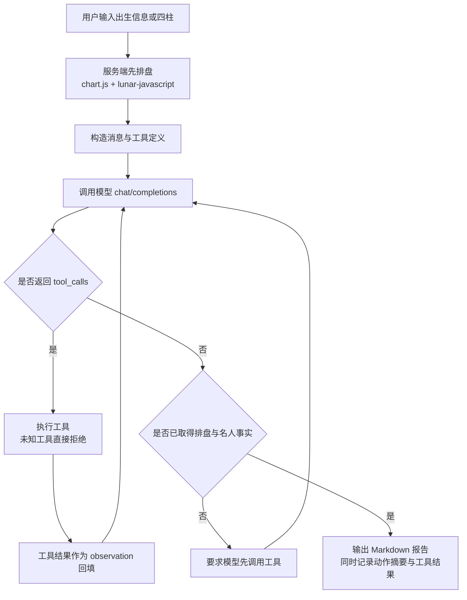

# 观命 · 八字命理智能分析平台

基于 **ReAct Agent** 的八字排盘与名人对照分析平台（课程设计项目）。输入出生信息或直接输入四柱，系统自动排盘、检索同八字名人参照，并由工具驱动的智能体生成分析报告。**排盘结果全部来自历法库计算，绝不交给模型"编造"。**

> 传统文化学习与娱乐用途，不构成科学预测，不应用于医疗、投资或任何重大人生决策。

---

## 1. 功能特性

| 模块 | 说明 |
| --- | --- |
| 出生信息排盘 | 公历生日 + 出生时间，由 `lunar-javascript` 计算四柱、纳音、藏干、十神 |
| 四柱直输 | 已知干支时可直接输入，服务端用五虎遁 / 五鼠遁校验干支组合是否自洽 |
| ReAct Agent | 模型自主选择工具 → 读取观察结果 → 生成 Markdown 报告，全过程可查看工具轨迹 |
| 名人对照 | 16 位有公历生日来源的名人，按柱位比对，严格区分"完整匹配"与"部分匹配" |
| 五行分布 | 表层八字五行计数可视化（明确标注不等于旺衰 / 喜用神） |
| LLM 可配置 | 网页端配置任意 OpenAI 兼容接口（地址、模型、密钥、温度、最大轮数） |
| 规则演示模式 | 未配置密钥时自动降级为纯本地规则报告，排盘与名人匹配完全可用，且不访问任何外部接口 |
| 报告导出 | 一键导出 Markdown 报告 |
| 本地记录 | 只保存最近 8 条出生输入（姓名 + 时间），不保存报告、不保存密钥 |

## 2. 技术栈

- **前端**：React 19 + Vite（JavaScript / ES Modules）、`react-markdown`、`lucide-react`
- **后端**：Node.js + Express 5（原生 `fetch` 调用模型，无额外 SDK）
- **历法**：`lunar-javascript`（服务端唯一排盘来源）
- **校验**：`zod`
- **测试**：Node.js 内置 `node:test`（29 项，覆盖排盘边界、Agent 循环、接口与密钥处理）

## 3. 目录结构

```
.
├─ server/
│  ├─ index.js             Express 应用与全部 API 路由
│  ├─ chart.js             排盘核心：历法调用、干支校验、十神 / 纳音 / 五行
│  ├─ celebrities.js       名人数据集（含生日来源）与柱位匹配
│  ├─ agent.js             ReAct 循环、工具定义、系统提示词、规则演示报告
│  └─ config.js            配置读写（密钥落盘）、OpenAI 兼容接口调用
├─ src/
│  ├─ App.jsx              页面：输入、命盘、名人、工具轨迹、报告、模型设置
│  ├─ api.js               前端接口封装
│  ├─ App.css / index.css  样式
│  └─ main.jsx
├─ test/
│  ├─ chart.test.js        排盘与干支校验（含立春、晚子时、非法输入）
│  ├─ celebrities.test.js  名人匹配规则（未知时辰绝不标为完全匹配）
│  ├─ agent.test.js        ReAct 循环、工具参数不可篡改结果、异常分支
│  └─ api.test.js          HTTP 接口、配置保存、密钥不回传、跨站拦截
├─ .github/copilot-instructions.md
├─ .env.example            环境变量示例
└─ .vscode/tasks.json      开发 / 测试 / 构建任务
```

## 4. 快速开始

要求 Node.js ≥ 20（开发环境使用 22.x）。

```bash
npm install
npm run dev        # 后端 127.0.0.1:3001 + 前端 127.0.0.1:5173
```

浏览器打开 **http://127.0.0.1:5173**，点击"一键示例"即可在未配置模型的情况下体验完整流程。

生产模式（前端构建产物由后端一并托管）：

```bash
npm run build
npm start          # http://127.0.0.1:3001
```

其它命令：

```bash
npm test           # 运行全部自动化测试
npm run lint       # oxlint 静态检查
```

## 5. 配置 LLM

三种方式，优先级从高到低：

1. **网页「模型设置」**：填写 Base URL、模型名、API Key、温度与最大工具调用轮数，点击"保存配置"。密钥写入服务端 `data/config.json`（已被 `.gitignore` 排除），接口只返回"是否已保存"，**从不返回密钥内容，也不写入日志**。可用"清除服务端已保存的密钥"删除。
2. **`data/config.json`**：直接编辑该文件（结构见下）。
3. **环境变量**：`LLM_BASE_URL` / `LLM_MODEL` / `LLM_API_KEY`，仅在 `data/config.json` 不存在时作为默认值生效。参考 `.env.example`，可用 `node --env-file=.env server/index.js` 启动。

```json
{
  "baseUrl": "https://api.deepseek.com/v1",
  "model": "deepseek-chat",
  "apiKey": "sk-...",
  "temperature": 0.6,
  "maxSteps": 5
}
```

- 接口需为 OpenAI 兼容的 `POST {baseUrl}/chat/completions`。
- **完整 ReAct 功能要求模型支持 `tools`（函数调用）**。"测试连接"仅验证基础对话可用，不代表工具调用一定可用；若模型不支持工具，会在达到最大轮数后提示失败，此时可直接使用规则演示模式。
- 本地推理服务（如 Ollama 的 `http://127.0.0.1:11434/v1`）通常不需要密钥：**Base URL 指向本机时不填密钥也会直接进入 LLM 模式**，便于本地调试。
- 若 Base URL 是公网地址且未配置密钥，则自动使用规则演示模式，避免误向外部服务发请求。

## 6. ReAct Agent 工作流程



工具清单（模型只能选择，不能改写参数）：

| 工具 | 作用 | 结果来源 |
| --- | --- | --- |
| `calculate_bazi` | 返回命盘的四柱、十神、纳音、五行计数 | 服务端 `chart.js`；输入与请求绑定，模型传入的参数一律忽略 |
| `search_celebrities` | 检索柱位相同的名人候选 | 服务端本地数据集，并明确返回 `exactCount` |
| `lookup_knowledge` | 查询五行、十神、月令、名人匹配的方法与局限说明 | 服务端内置知识条目 |

设计要点：

- **排盘与模型解耦**：命盘在进入 Agent 之前已经算好，工具返回服务端结果，模型无法通过函数参数伪造四柱（`test/agent.test.js` 有对应测试）。
- **事实优先**：若模型未调用 `calculate_bazi` / `search_celebrities` 就想直接给结论，会被要求先取事实，抑制纯生成式幻觉。
- **轨迹只展示动作与结果**：界面展示"动作 / 结果 / 完成"三类条目与工具返回摘要，不展示模型的隐藏思维链。

## 7. 排盘规则与流派说明

- 年柱以**立春**换年，月柱以**节气**换月（例：2000-02-04 立春 20:40，19:30 出生仍为 `己卯` 年 `丁丑` 月，23:30 出生为 `庚辰` 年 `戊寅` 月）。
- 晚子时（23:00–23:59）采用 `lunar-javascript` 默认流派 **sect=2：日柱算当天，时柱按次日日干起**，因此该组四柱不满足五鼠遁，属流派差异；四柱直输时两种组合都会被接受。
- 出生时间按**北京时间**输入，未校正真太阳时。
- 五行图只统计八个表层干支，**未计入藏干、月令、通根与旺衰**，不能据此直接判定身强身弱或喜用神。
- 直接输入四柱时不会反推出生日期（界面明确标注"未提供公历出生信息"）。

## 8. 名人数据集说明

- 数据位于 `server/celebrities.js`，目前 16 位人物，均使用**可核对的公历生日**并附来源链接。
- **所有种子人物的出生时辰均未知**，因此时柱不参与比对：每人只比对应位置上的年、月、日三柱。
- 因此 `exact: false` 恒成立，界面只标注"部分匹配 N 柱"，并逐条提示"出生时辰未核实，不能判定为四柱完全匹配"。该规则由 `test/celebrities.test.js` 强制校验。
- 扩充方式：在数组中追加 `[姓名, 公历生日, 简介, 来源链接]`；若确有可靠时辰来源，可扩展数据结构并相应放开 `timeKnown`。

## 9. API 一览

| 方法 | 路径 | 说明 |
| --- | --- | --- |
| GET | `/api/health` | 健康检查 |
| GET | `/api/config` | 读取配置（不含 `apiKey`，返回 `hasKey`） |
| PUT | `/api/config` | 保存配置；`apiKey` 留空表示保留原密钥，`clearKey: true` 表示清除 |
| POST | `/api/config/test` | 用当前配置发起一次最小对话，验证连通性 |
| POST | `/api/chart` | 只排盘并返回名人匹配（不调用模型） |
| POST | `/api/analyze` | 完整流程：排盘 + Agent 分析，返回 `chart` / `matches` / `trace` / `report` / `mode` |

请求体示例：

```json
{ "mode": "birth", "name": "张三", "date": "1990-05-20", "time": "10:00" }
{ "mode": "manual", "pillars": ["庚午", "辛巳", "乙酉", "辛巳"] }
```

失败时统一返回 `{ "error": "可读的中文说明" }`（HTTP 400）；同一时刻只允许一个分析在途，重复请求返回 429。

## 10. 安全与隐私

- API Key **只保存在服务端** `data/config.json`（`.gitignore` 已排除），不返回前端、不写入浏览器存储、不落日志。
- 前端本地存储只保留最近 8 条出生输入（姓名 / 时间），不含报告与密钥。
- 接口开启 `Cache-Control: no-store`，拒绝 `Sec-Fetch-Site: cross-site` 与来源不在允许列表的跨站请求；未开启 CORS。
- 后端默认只监听 `127.0.0.1`，不对局域网暴露。

## 11. 测试覆盖

```bash
npm test
# tests 29 / pass 29 / fail 0
```

- `chart.test.js`：固定命盘基准值、五行计数恒为 8、立春换年、晚子时规则、非法日期与非法干支、五虎遁 / 五鼠遁校验、早晚子时兼容
- `celebrities.test.js`：数据集结构、未知时辰绝不标为完全匹配、匹配数降序、时柱永不参与比对
- `agent.test.js`：完整 ReAct 循环与轨迹、模型无法篡改排盘事实、跳过工具会被要求补事实、未知工具被拒绝、超出最大轮数与空报告报错、无密钥走规则模式、本机端点无密钥仍走 LLM
- `api.test.js`：接口状态码与错误文案、规则演示模式、配置保存 / 保留 / 清除密钥、磁盘落盘内容、非法配置拒绝、跨站拦截、JSON 404

## 12. 后续可扩展方向

- 流式输出（SSE）与工具调用过程的实时轨迹
- 真太阳时校正（经度 + 均时差）与分钟级节气边界提示
- 更严谨的命理规则引擎：月令旺衰、通根透干、十神组合权重
- 名人数据集扩充与来源核验流程（含可靠时辰数据）
- Docker 部署与在线 Demo

---

## 免责声明

本项目为课程设计作品，仅用于软件工程实践与传统文化学习。命理推断不属于科学结论，请勿用于医疗、投资、婚恋或其他重大决策。
